<p align="center">
  
  
</p>

<h1 align="center">Instituto Tecnológico Nacional de México</h1>

<h2 align="center">Práctica migración</h2>

<p align="center">
<b>Alumno:</b><br>
Arellano Santos Jose Miguel<br><br>
<b>Materia:</b><br>
Administración de base de datos<br><br>
<b>Profesor:</b><br>
Diego Alberto Bollas Paredes
</p>

---

## Introducción

En esta práctica hice la migración de una base de datos en MariaDB. Migrar quiere decir pasar una base de datos de un lugar a otro (otro servidor, otra versión o simplemente otra base con otro nombre) sin perder nada de información.

Yo tenía una base llamada `biblioteca` y la pasé a una nueva llamada `biblioteca_nueva`. Para esto saqué un archivo de respaldo con todo lo que tenía la base (tablas, datos y la vista) y luego lo metí en la base nueva. Al final comprobé que todo hubiera quedado igual: contando los registros, comparando los checksum, probando la vista y probando que la llave foránea siguiera funcionando.

Todo lo hice desde la terminal de mi máquina virtual con Ubuntu (el servidor se llama `servidor-bd`), con el usuario `root` de MariaDB. La versión de MariaDB que tengo instalada es la 10.3.39.

---

## Desarrollo

### Paso 1. Crear la base de datos de origen

Primero entré a MariaDB con mi usuario `root` y creé la base `biblioteca`. Después creé la tabla `autores`, que guarda el id, el nombre y el país de cada autor.

```sql
mariadb -u root -p

CREATE DATABASE biblioteca;
USE biblioteca;

CREATE TABLE autores(
  id INT AUTO_INCREMENT PRIMARY KEY,
  nombre VARCHAR(100) NOT NULL,
  pais VARCHAR(50)
);
```

**Resultado:** la base y la tabla se crearon sin errores (`Query OK`).

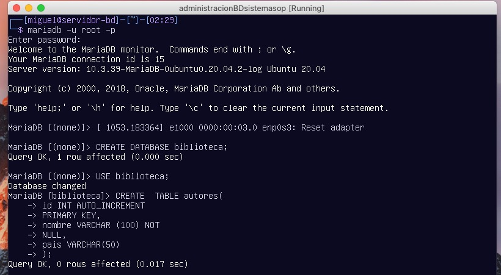

Luego creé la tabla `libros`. Esta tiene una llave foránea (`autor_id`) que apunta al `id` de la tabla `autores`, así cada libro queda ligado a un autor que sí existe.

```sql
CREATE TABLE libros (
  id INT AUTO_INCREMENT PRIMARY KEY,
  titulo VARCHAR(150) NOT NULL,
  anio INT,
  autor_id INT NOT NULL,
  FOREIGN KEY (autor_id) REFERENCES autores(id)
);
```

**Resultado:** la tabla se creó bien (`Query OK`).

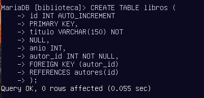

Después metí los datos: 3 autores y 4 libros. También creé una vista llamada `v_libros_autor`, que junta las dos tablas para ver el título del libro, el año y el nombre del autor. Al final la consulté para ver que funcionara.

```sql
INSERT INTO autores (nombre,pais) VALUES
('Gabriel Garcia Marques', 'colombia'),
('Julio Cortazar', 'Argentina'),
('Octavio Paz', 'Mexico');

INSERT INTO libros (titulo, anio, autor_id) VALUES
('cien anos de soledad', 1967, 1),
('El amor en los tiempos del colera', 1985, 1),
('Rayuela',1963, 2),
('El laberintode la soledad', 1950, 3);

CREATE VIEW v_libros_autor AS
SELECT l.titulo, l.anio,
a.nombre AS autor
FROM libros l
JOIN autores a ON a.id = l.autor_id;

SELECT * FROM v_libros_autor;
```

**Resultado:** se insertaron 3 autores y 4 libros, y la vista mostró los 4 libros con el nombre de su autor.

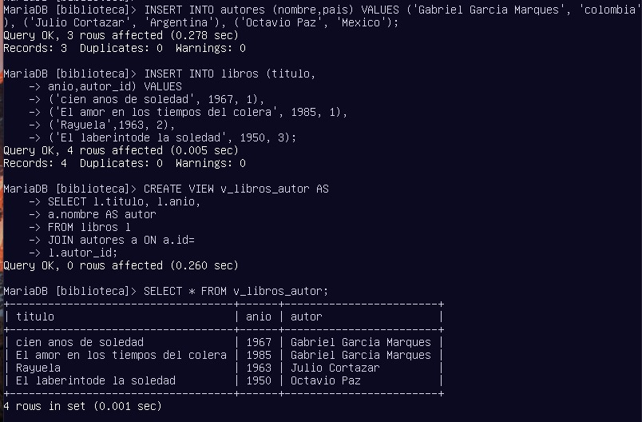

---

### Paso 2. Guardar los datos del origen

Antes de migrar quise guardar cuántos registros tenía cada tabla y el checksum de cada una, para después compararlos con los de la base nueva. El checksum es un número que sale del contenido de la tabla: si dos tablas tienen el mismo contenido, les sale el mismo número.

```bash
mariadb -u root -p -e "
SELECT COUNT(*) AS autores
FROM biblioteca.autores;
SELECT COUNT(*) AS libros
FROM biblioteca.libros;
CHECKSUM TABLE
biblioteca.autores,
biblioteca.libros;"
```

**Resultado:**

| Dato | Origen (`biblioteca`) |
|---|---|
| Registros en autores | 3 |
| Registros en libros | 4 |
| Checksum de autores | 1184143278 |
| Checksum de libros | 2367132664 |

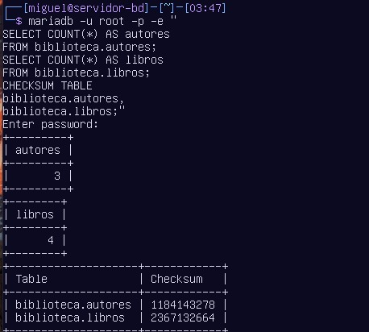

---

### Paso 3. Respaldo de seguridad antes de migrar

Antes de mover nada hice un respaldo de la base `biblioteca`, por si algo salía mal poder regresar a como estaba. Aquí usé `mysqldump`. En las versiones nuevas de MariaDB este comando se llama `mariadb-dump`, pero mi versión es la 10.3.39 y en esa todavía se llama `mysqldump`; hace exactamente lo mismo.

Usé la opción `--databases` para que el respaldo incluya también la creación de la base.

```bash
mysqldump -u root -p --databases biblioteca > respaldo_previo.sql
ls -lh respaldo_previo.sql
```

**Resultado:** se creó el archivo `respaldo_previo.sql` y pesa 4.6K.

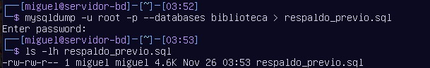

---

### Paso 4. Exportar la base de datos

Ahora sí saqué el archivo para la migración. Esta vez **no** usé `--databases`, porque quería poder meter los datos en una base con otro nombre. Las demás opciones que usé:

- `--single-transaction`: para que el respaldo salga completo y consistente sin bloquear las tablas.
- `--routines`, `--triggers` y `--events`: para que también se guarden las rutinas, triggers y eventos, si es que hubiera.

```bash
mysqldump -u root -p --single-transaction --routines --triggers --events biblioteca > biblioteca_migracion.sql
```

**Resultado:** el comando no mostró ningún error, lo que significa que el archivo `biblioteca_migracion.sql` se generó bien.

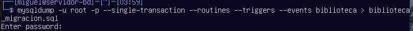

---

### Paso 5. Crear la base de datos de destino

Creé la base vacía `biblioteca_nueva`, que es a donde voy a pasar todo.

```bash
mariadb -u root -p -e "CREATE DATABASE biblioteca_nueva;"
```

**Resultado:** no marcó error, así que la base se creó.


---

### Paso 6. Importar en el destino

Metí el archivo que exporté dentro de la base `biblioteca_nueva`.

```bash
mariadb -u root -p biblioteca_nueva < biblioteca_migracion.sql
```

**Resultado:** la importación terminó sin errores.

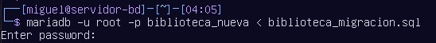

---

### Paso 7. Validar que todo quedó bien

#### 7.1 Comparar registros y checksum

Repetí las mismas consultas del paso 2, pero ahora sobre `biblioteca_nueva`.

```bash
mariadb -u root -p -e "
SELECT COUNT(*) AS autores
FROM
biblioteca_nueva.autores;
SELECT COUNT(*) AS libros
FROM biblioteca_nueva.libros;
CHECKSUM TABLE
biblioteca_nueva.autores,
biblioteca_nueva.libros;"
```

**Resultado:** salieron 3 autores y 4 libros, y los checksum fueron los mismos que en el origen (1184143278 para autores y 2367132664 para libros). Esto confirma que no se perdió ni cambió ningún dato.

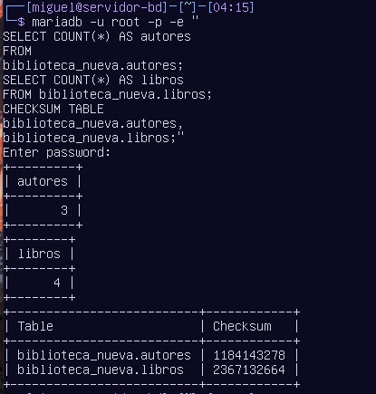

#### 7.2 Probar la vista

```bash
mariadb -u root -p -e "SELECT * FROM biblioteca_nueva.v_libros_autor;"
```

**Resultado:** la vista funciona y muestra los 4 libros con su autor, igual que en la base original.

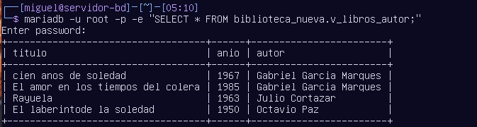

#### 7.3 Probar la llave foránea

Intenté meter un libro con un `autor_id` que no existe (el 999). Si la llave foránea se migró bien, la base lo tiene que rechazar.

```bash
mariadb -u root -p -e "INSERT INTO
biblioteca_nueva.libros
(titulo, anio,autor_id)
VALUES ('prueba' , 2020,
999);"
```

**Resultado:** me salió el error `ERROR 1452 (23000): Cannot add or update a child row: a foreign key constraint fails`. Es lo que esperaba, porque quiere decir que la llave foránea sigue funcionando en la base nueva.

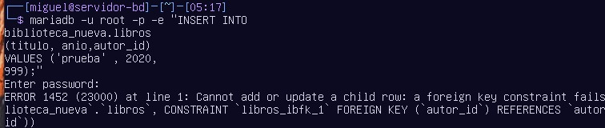

#### 7.4 Revisar la estructura de la tabla

```bash
mariadb -u root -p -e "SHOW
CREATE TABLE
biblioteca_nueva.libros\G"
```

**Resultado:** en la estructura de `libros` aparece la llave foránea `libros_ibfk_1` que apunta a `autores (id)`, y el motor InnoDB. Todo quedó igual que en la base original.

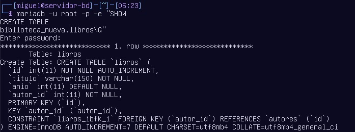

---

### Paso 8. Resumen de la comparación

| Comprobación | Origen | Destino | ¿Coincide? |
|---|---|---|---|
| Registros en autores | 3 | 3 | Sí |
| Registros en libros | 4 | 4 | Sí |
| Checksum de autores | 1184143278 | 1184143278 | Sí |
| Checksum de libros | 2367132664 | 2367132664 | Sí |
| La vista funciona | Sí | Sí | Sí |
| La llave foránea funciona | Sí | Sí (error 1452) | Sí |

---

## Conclusiones

Con esta práctica aprendí cómo se migra una base de datos en MariaDB usando solo la terminal: primero se hace un respaldo, luego se exporta, se crea la base nueva, se importa y al final se comprueba que todo esté igual. En mi caso la migración salió bien: los registros y los checksum coincidieron, la vista funcionó y la llave foránea siguió rechazando datos que no existen.

Lo más importante que me llevo es que no basta con que la importación no marque errores, también hay que comprobar que los datos quedaron completos. Para eso sirven el conteo de registros y el checksum. También entendí por qué conviene hacer un respaldo antes de migrar, y que si exporto sin `--databases` puedo meter los datos en una base con otro nombre.

Algo que me llamó la atención es que en mi versión de MariaDB (10.3.39) el comando de respaldo todavía se llama `mysqldump`, y en las versiones nuevas es `mariadb-dump`. Si el destino fuera otro servidor, el proceso sería parecido, solo tendría que copiar el archivo `.sql` al otro servidor antes de importarlo.
